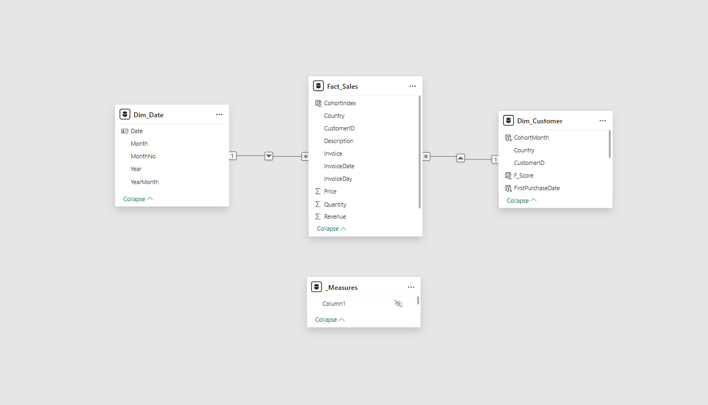
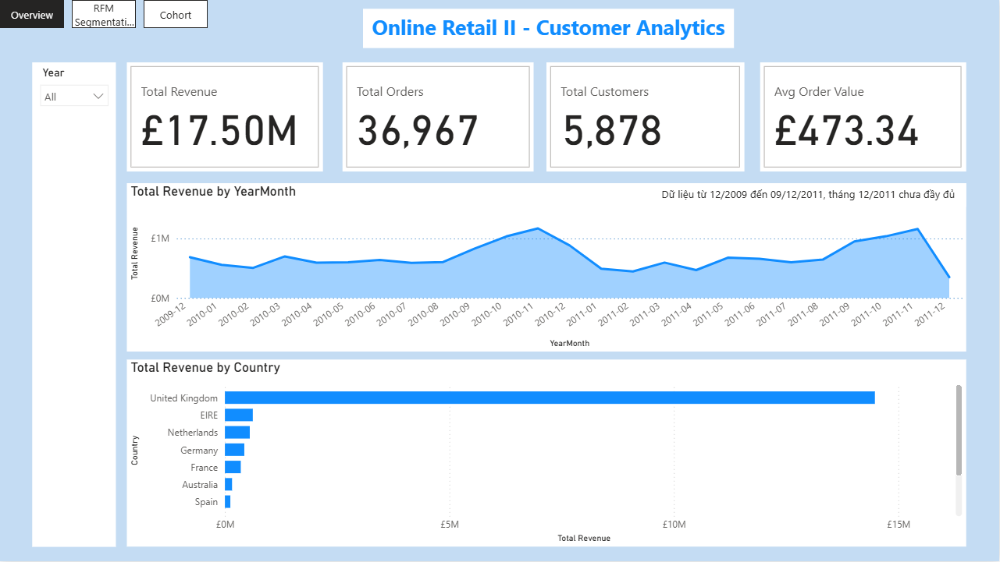
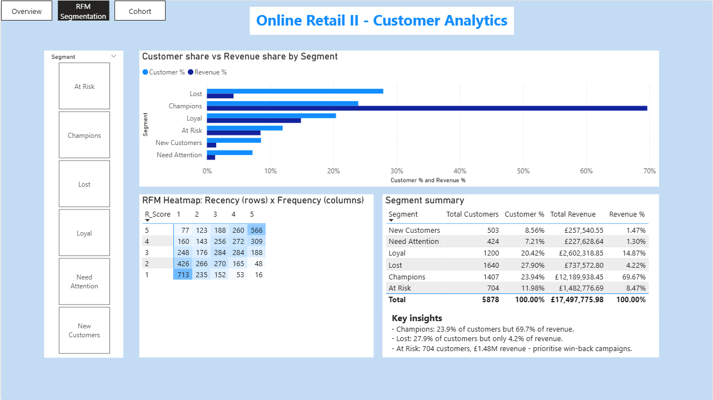
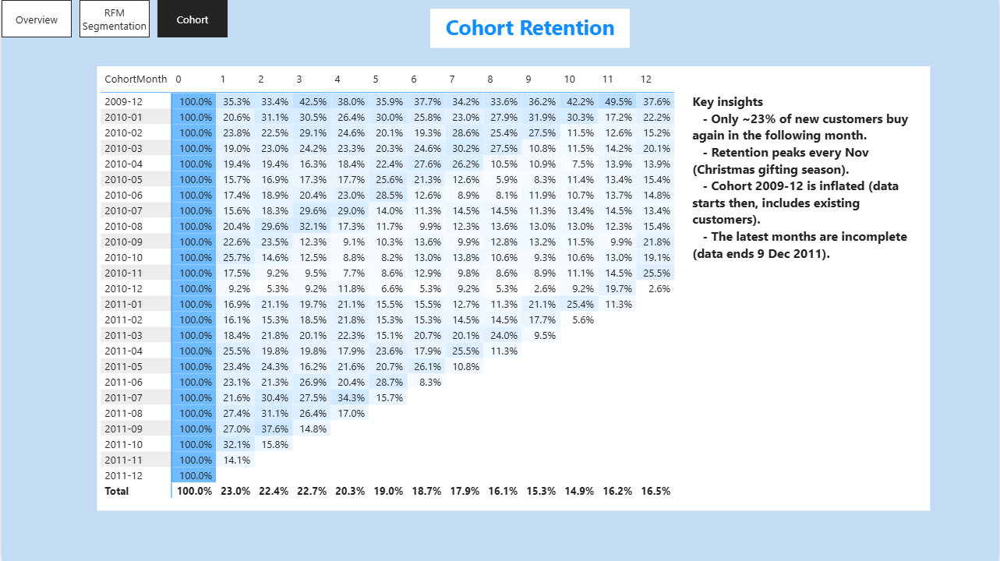
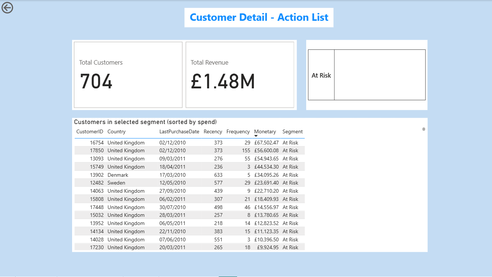

# Phân tích khách hàng bán lẻ: RFM Segmentation & Cohort Retention (Power BI)

Dashboard Power BI phân tích hành vi khách hàng của một shop bán buôn quà tặng online ở Anh, trả lời 3 câu hỏi:

1. Ai là nhóm khách quan trọng nhất cần giữ chân?
2. Ai đang có nguy cơ rời bỏ và cần được kéo lại?
3. Khách mới mua lần đầu có quay lại không, và giữ chân được bao lâu?


## Tóm tắt kết quả

| Chỉ số | Giá trị |
|---|---|
| Doanh thu | £17,50M |
| Số hóa đơn | 36.967 |
| Số khách hàng | 5.878 |
| Giá trị đơn trung bình | £473,34 |

**Phát hiện chính**

- **Champions** chỉ chiếm 23,9% số khách nhưng tạo ra **69,7% doanh thu**.
- **Lost** chiếm 27,9% số khách nhưng chỉ đóng góp **4,2% doanh thu**.
- Khoảng **23%** khách mới mua lại ở tháng kế tiếp, sau đó tỷ lệ giữ chân giảm dần và dao động quanh 15-18% từ tháng thứ 7 đến tháng thứ 12.
- Doanh thu tăng mạnh vào **tháng 9 đến tháng 11** mỗi năm (mùa mua quà cuối năm), đồng thời tỷ lệ quay lại của các cohort cũng tăng vọt vào tháng 11/2010.
- Nhóm **At Risk** (704 khách, £1,48M doanh thu) từng mua nhiều nhưng đã lâu không quay lại, đây là nhóm đáng can thiệp trước.

**Đề xuất hành động**

1. Chạy chiến dịch kéo khách quay lại (voucher, email cá nhân hóa) cho nhóm **At Risk**, ưu tiên khách có chi tiêu cao nhất. Danh sách khách cụ thể nằm ở trang Customer Detail.
2. Xây chương trình chăm sóc khách mới trong 30 ngày đầu, vì điểm rơi lớn nhất của tỷ lệ giữ chân xảy ra ngay sau lần mua đầu tiên.
3. Chuẩn bị hàng hóa và ngân sách marketing trước mùa cao điểm tháng 9-11.
4. Giữ chân nhóm **Champions** bằng ưu đãi thành viên, vì chỉ cần mất một phần nhỏ nhóm này là doanh thu giảm mạnh.

## Dữ liệu

- Nguồn: **Online Retail II (UCI)** trên Kaggle: [ĐIỀN LINK DATASET VÀO ĐÂY](https://www.kaggle.com).
- Giai đoạn: 12/2009 đến 09/12/2011, 1.067.371 dòng gốc, sau làm sạch còn **805.547 dòng**.
- File dữ liệu gốc không được đưa lên repo vì dung lượng lớn (khoảng 95 MB). Tải từ Kaggle nếu muốn chạy lại.

### Các bước làm sạch (Power Query)

| Bước | Lý do |
|---|---|
| Loại dòng thiếu `Customer ID` | RFM tính theo từng khách, không có ID thì không xác định được khách |
| Loại hóa đơn hủy (mã bắt đầu bằng `C`) | Đơn hủy làm sai doanh thu và tần suất mua |
| Giữ dòng có `Quantity > 0` và `Price > 0` | Loại dòng điều chỉnh, dòng giá bằng 0 |
| Loại 2 dòng có `Quantity >= 50.000` | Ngoại lai làm phồng chi tiêu của một khách (ví dụ một khách có tổng chi £168K chỉ với 2 hóa đơn) |
| Thêm cột `Revenue = Quantity x Price` | Doanh thu của từng dòng |
| Thêm cột `InvoiceDay` (chỉ có ngày) | Để nối với bảng lịch `Dim_Date` |

## Mô hình dữ liệu (Star Schema)



- **Fact_Sales**: giao dịch ở mức dòng sản phẩm.
- **Dim_Customer**: mỗi khách một dòng, chứa Recency, Frequency, Monetary, điểm R-F-M, Segment, tháng mua đầu tiên.
- **Dim_Date**: bảng lịch riêng, nối với `Fact_Sales[InvoiceDay]`.
- **_Measures**: bảng riêng chứa toàn bộ measure DAX.

Quan hệ: `Dim_Date` (1) → `Fact_Sales` (nhiều), `Dim_Customer` (1) → `Fact_Sales` (nhiều), hướng lọc Single.

## Phương pháp

### RFM Segmentation

- **Recency**: số ngày từ lần mua gần nhất đến ngày chốt (ngày cuối của dữ liệu cộng 1). Không dùng `TODAY()` vì dữ liệu cũ.
- **Frequency**: số hóa đơn riêng biệt (`DISTINCTCOUNT`).
- **Monetary**: tổng chi tiêu.
- Mỗi chỉ số được chấm **1-5 theo quintile** (`PERCENTILE.INC`). Recency càng nhỏ điểm càng cao.

Quy tắc gán nhóm (xét theo thứ tự từ trên xuống, dừng ở điều kiện đúng đầu tiên):

| Nhóm | Điều kiện |
|---|---|
| Champions | R >= 4 và F >= 4 |
| Loyal | R >= 3 và F >= 3 |
| New Customers | R >= 4 và F <= 2 |
| At Risk | R <= 2 và F >= 3 |
| Lost | R <= 2 và F <= 2 |
| Need Attention | Các trường hợp còn lại |

Kết quả:

| Nhóm | Số khách | % khách | Doanh thu | % doanh thu |
|---|---|---|---|---|
| Champions | 1.407 | 23,94% | £12.189.938 | 69,67% |
| Loyal | 1.200 | 20,42% | £2.602.319 | 14,87% |
| At Risk | 704 | 11,98% | £1.482.777 | 8,47% |
| Lost | 1.640 | 27,90% | £737.573 | 4,22% |
| New Customers | 503 | 8,56% | £257.541 | 1,47% |
| Need Attention | 424 | 7,21% | £227.629 | 1,30% |

### Cohort Retention

- Cohort = nhóm khách theo **tháng mua đầu tiên**.
- `CohortIndex` = số tháng kể từ tháng mua đầu (0 là tháng mua đầu).
- `Retention % = số khách còn mua ở tháng n / số khách của cohort ở tháng 0`.

## Các trang dashboard

| Trang | Nội dung |
|---|---|
| Overview | 4 KPI, xu hướng doanh thu theo tháng, top quốc gia, slicer năm |
| RFM Segmentation | Heatmap R x F, so sánh % khách và % doanh thu theo nhóm, bảng tóm tắt, slicer nhóm |
| Cohort | Ma trận tỷ lệ giữ chân theo tháng, tô màu gradient |
| Customer Detail | Trang drill-through: chuột phải vào một nhóm để xem danh sách khách cụ thể |






## Hạn chế của dữ liệu và phân tích

- Dữ liệu kết thúc ngày 09/12/2011, nên **tháng 12/2011 chưa đầy đủ** (đường doanh thu rơi ở cuối biểu đồ là do dữ liệu, không phải do kinh doanh).
- **Cohort 2009-12** có tỷ lệ giữ chân cao bất thường vì dữ liệu bắt đầu từ tháng đó, nhóm này lẫn cả khách đã mua từ trước.
- RFM được tính trên **toàn bộ giai đoạn** bằng cột tính sẵn, nên slicer năm không tính lại nhóm khách. Muốn phân nhóm theo từng năm cần chuyển sang measure động.
- Shop bán buôn nên có những đơn số lượng rất lớn (hàng nghìn đơn vị). Các đơn này được giữ lại, chỉ loại 2 dòng ngoại lai ở mức từ 50.000 đơn vị.

## Cấu trúc repo

```
.
├── README.md
├── RFM_Dashboard.pbix
├── dax/
│   └── measures.md      # toàn bộ công thức DAX và Power Query
└── images/
    ├── demo.gif
    ├── data_model.png
    ├── page1_overview.png
    ├── page2_rfm.png
    ├── page3_cohort.png
    └── page4_customer_detail.png
```

## Cách mở file

Mở `RFM_Dashboard.pbix` bằng **Power BI Desktop** (miễn phí). Nếu Power BI báo mất nguồn dữ liệu khi làm mới, tải lại file CSV từ Kaggle rồi chọn **Transform data** → **Data source settings** để trỏ lại đường dẫn.

## Kỹ năng thể hiện

Power Query (làm sạch dữ liệu), Star Schema, DAX (CALCULATE, DISTINCTCOUNT, DATEDIFF, PERCENTILE.INC, SWITCH, VAR), RFM, Cohort Analysis, drill-through, thiết kế dashboard, rút insight và đề xuất hành động.
